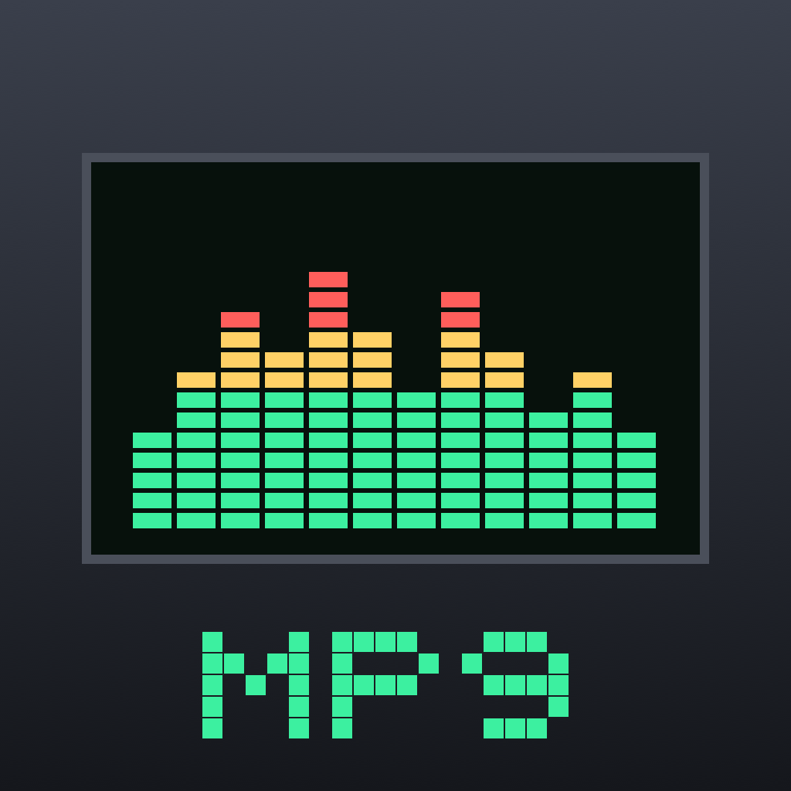

# Amplayer



图标是一支辉光管（Nixie tube），灯丝弯成八分音符，呼应经典播放器那块亮着的数码屏。

iOS 音乐播放器，界面像素级复刻经典 Winamp 2.x，可加载 `.wsz` 皮肤。可以播放本机、NAS、媒体服务器和网盘里的音乐。

调研结论与路线图见 [Docs/ROADMAP.md](Docs/ROADMAP.md)。

## 功能

- **经典三窗口**：主窗口、10 段均衡器、播放列表，按屏幕宽度等比放大，最近邻插值保证像素清晰
  - 主窗口：时间（点按切换剩余时间，暂停时闪烁）、滚动标题（中文自动改用系统字体）、kbps/kHz/声道、频谱与示波器（viscolor.txt 配色）、进度、音量、平衡、随机/循环（关→全部→单曲）
  - 均衡器：10 段 + 前级放大、开关、19 个预设、曲线图；双击滑块归零
  - 播放列表：ADD / REM / SEL / MISC / LIST 菜单，排序、反转、打乱、去重、裁剪，保存与打开 M3U/PLS，点歌名直接播放，长按可多选、查看信息或离线下载
  - 左上角按钮打开侧边总控菜单：来源、曲库、窗口开关、可视化、皮肤、设置
  - 歌词：点播放列表窗口的标题栏在列表和歌词之间切换（侧边菜单里也有）；自动读取同名 .lrc（GBK/UTF-8 都行）、群晖和 Navidrome 的歌词、文件内嵌歌词，滚动高亮，点一行跳过去，长按可导入 .lrc
- **皮肤**：内置 6 套原创皮肤（Graphite、Nixie 辉光、Deep Ocean 深海、Sakura 樱、Synthwave 霓虹、Ivory 象牙），全部代码绘制；支持导入任意 Winamp 2.x `.wsz` 皮肤，缺少的位图用内置皮肤补齐。皮肤页有 Winamp Skin Museum 入口，下载的 `.wsz` 可在“文件”App 中直接用 Amplayer 打开
- **来源**
  | 类型 | 说明 |
  |---|---|
  | 本机文件 | “文件”App › Amplayer，或从“文件”导入 |
  | WebDAV | 含 Alist / OpenList（可把各种网盘转成 WebDAV）、群晖 WebDAV Server、Nextcloud |
  | SMB 2/3 | Windows 共享、各类 NAS |
  | Subsonic / OpenSubsonic | Navidrome、Airsonic、Gonic、Ampache |
  | Jellyfin / Emby | 媒体库、专辑、艺术家、文件夹浏览 |
  | 群晖 DSM | 支持 IP / 域名 / **QuickConnect ID**；File Station 浏览全部共享文件夹（不依赖索引），Audio Station 有索引时另有专辑、播放列表 |
  | UPnP / DLNA | 几乎所有 NAS 自带的媒体服务器 |
  | 阿里云盘 / 百度网盘 | 走官方开放平台 OAuth，需要先配置 AppKey（见下） |
- **局域网发现**：Bonjour（SMB、WebDAV）+ SSDP（DLNA）
- **缓存**：网络曲目完整缓存后播放，并预缓存下一首；LRU 上限可调；支持离线下载
- **曲库**：扫描来源进曲库，按歌曲、艺术家、专辑浏览和搜索
- **系统集成**：后台播放、锁屏与控制中心、耳机线控、来电打断后恢复、AirPlay

支持的格式：MP3、AAC/M4A、ALAC、FLAC、**APE**、WAV、AIFF、CAF、Opus（CAF 封装）。APE 用内置的 Monkey's Audio 解码器，其余走 Core Audio。

## 工程结构

```
App/                     SwiftUI 界面
  Skin/                  经典三窗口（精灵图渲染、滑块、可视化）
  Screens/               来源、浏览、曲库、皮肤、设置
Packages/AmplayerKit/
  AmplayerCore                曲目、播放队列、M3U/PLS、均衡器
  AmplayerAudio               AVAudioEngine 播放器、10 段 EQ、vDSP 频谱、标签读取、APE 流式解码
  MonkeysAudio           Monkey's Audio SDK（C++）+ C 接口
  AmplayerSources             各协议来源、Keychain、局域网发现
  AmplayerCache               下载缓存、LRU、离线
  AmplayerSkin                .wsz 解析（自带 ZIP 读取器）、精灵图表、默认皮肤绘制
  AmplayerKit                 播放总控、曲库、来源与皮肤管理
UITests/                 XCUITest 端到端测试
Tools/                   测试服务器脚本、图标生成
```

## 构建（在 Mac 上）

```sh
cp Config/Signing.local.xcconfig.example Config/Signing.local.xcconfig   # 填入 Team ID
xcodegen generate
xcodebuild -project Amplayer.xcodeproj -scheme Amplayer -destination "platform=iOS Simulator,name=Amplayer iPhone" build
```

网盘直连需要开放平台的应用凭据：复制 `Config/Secrets.xcconfig.example` 为 `Config/Secrets.local.xcconfig` 并填写。不配置时，界面会提示改用 Alist/OpenList 的 WebDAV。

## 测试

```sh
# 单元测试（macOS 上运行 Swift 包测试）
(cd Packages/AmplayerKit && swift test)

# 用真实皮肤验证解析：指向 Webamp 仓库里的 base-2.91.wsz（不入库）
(cd Packages/AmplayerKit && AMP_TEST_WSZ=/path/to/base-2.91.wsz swift test)

# 真实群晖（凭据只走环境变量，不要写进文件）
(cd Packages/AmplayerKit && AMP_SYNO_URL=https://nas:5001 AMP_SYNO_USER=xxx AMP_SYNO_PASS=xxx AMP_SYNO_QC=<QuickConnect ID> swift test --filter Synology)

# 端到端：启动 WebDAV、DLNA、SMB、Navidrome、Jellyfin 容器，再跑在线测试
Tools/test-servers.sh
(cd Packages/AmplayerKit && AMP_LIVE=1 swift test)

# 界面测试（需要上面的 WebDAV 容器，模拟器 Documents 里放几首测试音频）
xcodebuild test -project Amplayer.xcodeproj -scheme Amplayer -destination "platform=iOS Simulator,name=Amplayer iPhone"
```

调试版支持用启动参数驱动界面，见 `App/DebugHooks.swift`。

## 许可

依赖只使用 MIT / Apache / LGPL（AMSMB2 以动态库链接）。详见 [THIRD_PARTY_LICENSES.md](THIRD_PARTY_LICENSES.md)。Amplayer 与 Winamp / Nullsoft / Llama Group 无关。

## 许可证

本项目代码以 [MIT](LICENSE) 许可发布。第三方组件（Monkey's Audio SDK、AMSMB2/libsmb2 等）沿用各自许可，见 [THIRD_PARTY_LICENSES.md](THIRD_PARTY_LICENSES.md)。
